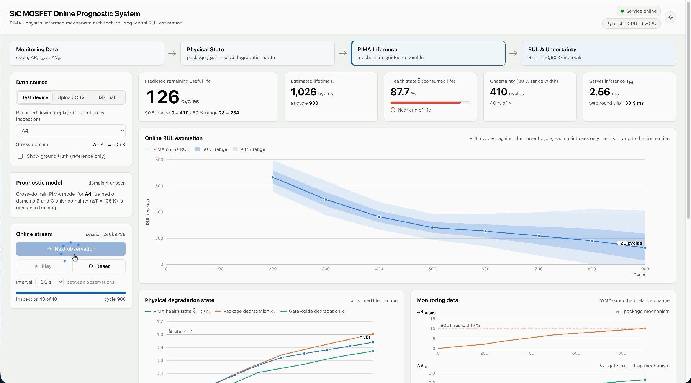

# PIMA Online Prognosis for SiC MOSFETs

**Online remaining useful life (RUL) prediction of SiC MOSFETs under unseen thermal stress, with a physics informed mechanism architecture (PIMA).**

Monitoring data arrive one inspection at a time. A server-side PIMA model turns each new inspection into an updated RUL estimate with 50 % and 90 % intervals, using only the history observed so far.

**Try it: [http://45.32.65.27:8000](http://45.32.65.27:8000)**

## Demo video

https://github.com/user-attachments/assets/e5fbab52-cfdf-4c61-984e-0663ca1b9390

*Click the image to open the video (27 s). A held-out device is replayed inspection by inspection; the RUL estimate, its intervals and the physical degradation state update after every inspection.*

## Using the live demo

1. Open [http://45.32.65.27:8000](http://45.32.65.27:8000).
2. Under **Data source → Test device**, pick a device. Each device is predicted by a model trained only on the two other stress domains, so its own stress is unseen in training.
3. Press **Next observation** to send one inspection, or **Play** to stream them. The server returns the prognosis for that inspection.
4. **Show ground truth** overlays the true RUL for reference. It is never sent to the model.
5. **Upload CSV** or **Manual** runs the model on your own data (`cycle`, `rds_on_pct`, `vth_pct`).

The demo runs on a small cloud server and may occasionally be offline.

## Online deployment

The trained model runs as a containerized inference service (Docker, FastAPI, PyTorch on CPU) on a cloud server with **1 vCPU and 1 GB of memory, without a GPU**. Model parameters are fixed during deployment. Every inspection is processed causally, using only the history observed up to that point.

| Item                              | Value                                                   |
| ----------------------------------- | --------------------------------------------------------- |
| Hardware                          | 1 vCPU (AMD EPYC), 1 GB RAM, no GPU                     |
| Server-side time per update, mean | 1.6 ms (consecutive updates), 3.0 ms (isolated updates) |
| Memory of the inference service   | < 0.3 GB                                                |

The time per update is measured inside the server and covers the whole update, from the new inspection to the RUL estimate and its intervals. It excludes network transfer.

---

© 2026 The authors. All rights reserved.
